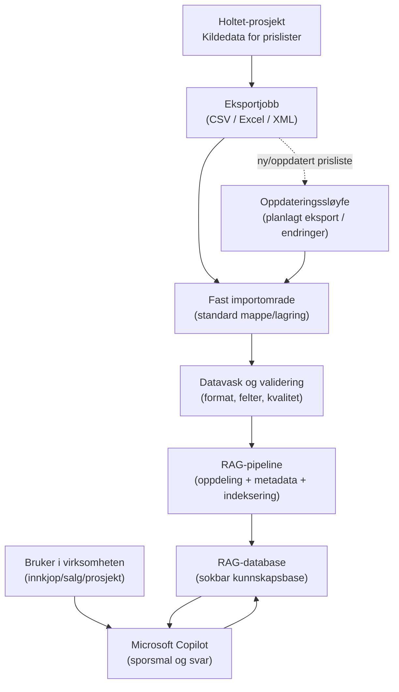

# Flytdiagram: eksport av prislister fra Holtet til RAG-database og Microsoft Copilot

Dette diagrammet viser en enkel arbeidsflyt for hvordan prislister kan hentes fra Holtet-prosjektet, legges i et fast importomrade, og brukes videre i en RAG-database som grunnlag for svar i Microsoft Copilot.

## Forklaring for ikke-tekniske

### Hva er dette?
- **Holtet** er stedet der prislistene lages eller vedlikeholdes.
- Prislistene **eksporteres** regelmessig (for eksempel som fil).
- Filene legges i et **fast importomrade** (en fast "innkurv").
- Derfra leses filene inn i en **RAG-database**.

### Hva betyr RAG-database?
Tenk pa RAG-databasen som et smart bibliotek:
- Den lagrer ikke bare dokumenter, men ogsa innholdet pa en mate som er lett a finne igjen.
- Nar noen sporrer Copilot, kan Copilot hente relevante deler fra dette biblioteket.
- Resultatet blir mer presise og oppdaterte svar om priser.

### Hvordan kan dette brukes i praksis?
- Salg og innkjop kan stille sporsmal i naturlig sprak, f.eks.:
  - "Hva er gjeldende pris pa produkt X?"
  - "Hvilke prisendringer kom denne maneden?"
- Copilot svarer raskt basert pa importerte prislister.
- Nar nye prislister eksporteres til fast omrade, blir kunnskapen oppdatert igjen.

### Hvorfor er dette nyttig?
- Mindre manuell leting i filer.
- Raskere svar for ansatte.
- Bedre kontroll pa at Copilot bruker oppdaterte prislister.
